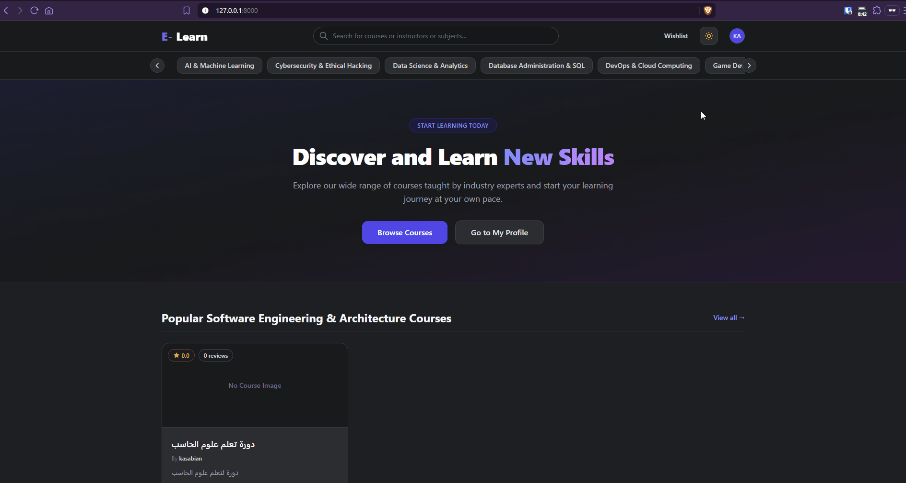
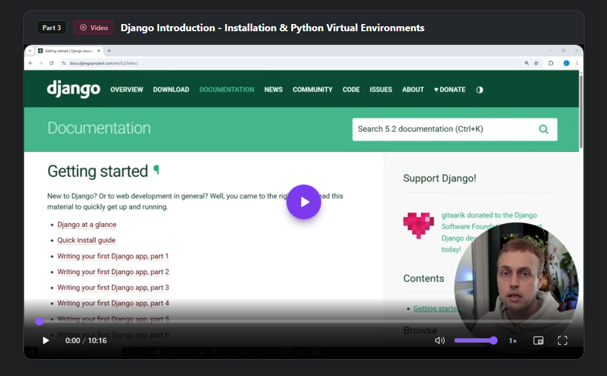
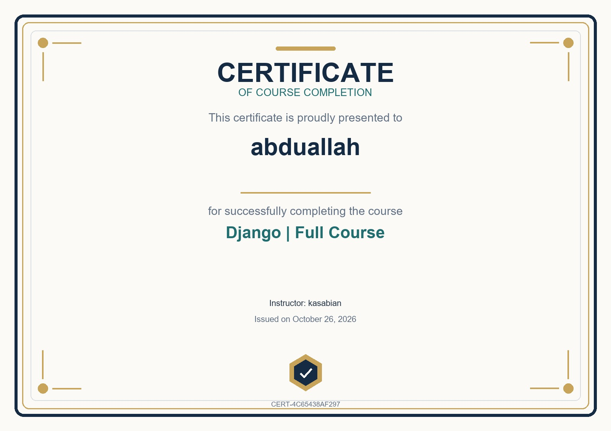
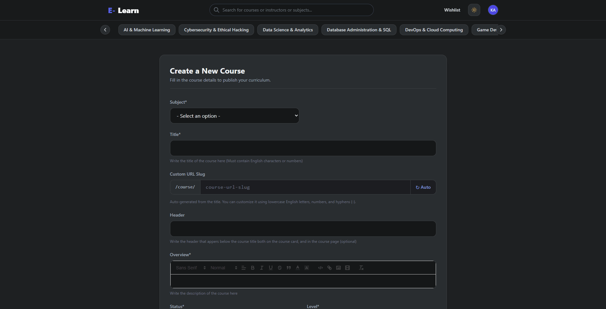

# 🎓 E-Learn — Full-Stack Django LMS

[](https://www.python.org/)
[](https://www.djangoproject.com/)
[](https://www.postgresql.org/)
[](https://tailwindcss.com/)
[](https://www.docker.com/)

A modern, Learning Management System (LMS) built with **Django 6**, **Tailwind CSS**, and **Vanilla JavaScript**. Engineered with multi-role access (Students & Instructors), polymorphic course content, real-time progress tracking, and automated completion certificate generation with bidirectional Arabic (RTL) typography.




---

## Table of Contents

- [What the Project Does](#what-the-project-does)
- [Why the Project is Useful](#why-the-project-is-useful)
  - [Key Features](#key-features)
  - [Engineering & Architectural Highlights](#engineering--architectural-highlights)
- [Getting Started](#getting-started)
  - [Method 1: Docker (Recommended)](#method-1-docker-recommended-)
  - [Method 2: Local Virtual Environment](#method-2-local-virtual-environment-)
  - [First Steps After Installation](#-first-steps-after-installation)
  - [Environment Configuration](#environment-configuration)
  - [Running Automated Tests](#running-automated-tests)
- [Project Architecture](#project-architecture)
- [Production Trade-Offs & Scalability](#production-trade-offs--scalability)
- [Where to Get Help](#where-to-get-help)
- [Maintainers & Contributing](#maintainers--contributing)
- [License](#license)

---

## What the Project Does

**E-Learn** is an end-to-end educational platform designed for both learners and educators:
- **Learners** can browse technical course catalogs across 11 disciplines, stream lectures with custom video controls, track completion percentages in real time, and earn cryptographically verified certificates.
- **Instructors** have access to a rich curriculum studio where they can build courses, publish modules, and attach polymorphic media items (YouTube embeds, direct video uploads, rich text readings, images, and downloadable resource files).
- **Administrators** supervise instructor applications via an approval queue with one-click bulk actions and granular permission assignments.

---

## Why the Project is Useful

### Key Features

#### 1. Student Experience
- **Catalog & Search:** Explore courses filtered by category, with multi-field navbar search matching titles, descriptions, categories, and instructor names.
- **Curriculum Player & Dynamic Tracking:** Real-time circular SVG progress indicator updating dynamically as modules are completed, with smart Next/Previous navigation buttons.
- **HMAC-Verified Certificates:** High-resolution A4 landscape PNG certificates (1600 × 1131 px) generated automatically upon reaching 100% completion. Features an unforgeable verification token (`CERT-XXXXXX`) derived from Django's `salted_hmac`.
- **Reviews & Ratings:** Authenticated 1-to-5 star rating system with written feedback (limited to one review per enrolled course, editable anytime).
- **Instructor Application:** Students can submit an instructor application directly from their profile with real-time status banners (Pending, Approved, Declined).


<p align="center">
  
  
</p>

#### 2. Instructor Studio
- **Polymorphic Course Content:** Modules support 4 distinct media types using Django `ContentType` generic relations:
  - **Video:** Dual-source handling supporting YouTube URLs (standard, shortened `youtu.be`, Shorts, and Live streams) or direct `.mp4`/`.webm` uploads.
  - **Text:** Rich-text lectures formatted with the Quill WYSIWYG editor.
  - **Image:** High-resolution technical diagrams with modal enlargement.
  - **File:** Downloadable lecture attachments (PDFs, ZIPs, code samples).
- **Draft & Publication Control:** Courses can be toggled between `Draft` (hidden from public view and secured via HTTP 404 from non-owners) and `Available`.
- **Dual-Role Flexibility:** Instructors can enroll in and learn from other instructors' courses while being strictly prevented from enrolling in their own.

#### 3. Frontend & Player Experience
- **Custom HTML5 Video Player:** Styled with dark glassmorphism, featuring an interactive hover-scrubber with timestamp preview, volume slider, playback rate switcher (0.25× to 2×), Picture-in-Picture (PiP), fullscreen mode, and keyboard shortcuts (`Space`, `J`, `K`, `L`, `0-9`).
- **Telegram-Style Circular Theme Transition:** Dark/Light mode toggle powered by the native browser **View Transitions API**, animating a radial `clip-path` circle expanding from the click coordinates.
- **Zero-FOUC Initializer:** In-head synchronous theme bootstrapping ensuring zero Flash of Unstyled Content on initial load and back-forward cache (`pageshow`).

---

### Engineering & Architectural Highlights

- **Smart Multilingual Slug Heuristics (`courses/utils.py`):**
  Solves Django's standard `slugify()` limitation with Arabic and non-Latin scripts:
  - *Bilingual Titles (e.g., "أساسيات بايثون | Python Basics"):* Automatically isolates technical English keywords ($\ge$ 3 characters) for clean SEO URLs (`python-basics`).
  - *Arabic & Technical Abbreviations:* Transliterates phonetically using `unidecode`.
  - *Collision Resolution:* Generates `-1`, `-2` suffixes in a single indexed regex SQL query.
  - *Live Preview:* Debounced AJAX endpoint (`/api/generate-slug-preview/`) gives real-time validation in the course creation form.



- **Zero-Loss Data Migration on Account Upgrade (`accounts/services.py`):**
  Upgrading a student to an instructor safely migrates all `BaseProfile` data inside an atomic transaction (`@transaction.atomic`). Avatar images are detached via direct SQL `.update(photo=None)` before deleting `StudentProfile`, bypassing `django-cleanup` post-delete file destruction signals.
- **N+1 Query Elimination & In-Memory Caching:**
  - View querysets leverage `select_related('owner__instructor_profile')` and `prefetch_related('modules', 'contents__item')`.
  - Aggregates (`enrolled_students_count`, `annotated_avg_rating`, `annotated_reviews_count`) are pre-computed in SQL via `Count` and `Avg` annotations.
  - Subject categories in the global navigation bar are cached in RAM via `cache.get_or_set` with a 24-hour TTL and automated cache-invalidation hooks on model save/delete.

---

## Getting Started

You can run this project using **Docker (Recommended - Zero Database Setup)** or via a **Local Python Virtual Environment**.

---

### Method 1: Docker (Recommended) 🐳

This method is the fastest and spins up both the **Django web server** and **PostgreSQL 16** container automatically with persistent storage.

#### 1. Prerequisites
- [Docker Desktop](https://www.docker.com/products/docker-desktop/) installed and running.

#### 2. Clone the Repository
```bash
git clone https://github.com/kasabian22/Courses_platform.git
cd Courses_platform
```

#### 3. Copy Environment Configuration
*(The default values in `.env.example` work with Docker out of the box with zero edits needed!)*
- **macOS / Linux:**
  ```bash
  cp .env.example .env
  ```
- **Windows (CMD / PowerShell):**
  ```powershell
  copy .env.example .env
  ```

#### 4. Build and Start the Containers
```bash
docker compose up --build
```
Once the containers finish building and migrations run, open your browser to:
👉 **[http://localhost:8000](http://localhost:8000)**

#### 5. Create an Admin Account (Superuser)
In a new terminal window, run:
```bash
docker compose exec web python manage.py createsuperuser
```
Follow the prompts to create your admin credentials, then log into the admin dashboard at **[http://localhost:8000/admin/](http://localhost:8000/admin/)**.

---

### Method 2: Local Virtual Environment 🐍

Use this method if you prefer running Python directly on your system without Docker.

#### 1. Prerequisites
- **Python 3.12+**
- **PostgreSQL 16** running locally on port `5432` with a database named `elearning_db`.
  *(You can create it via `psql` using: `CREATE DATABASE elearning_db;` or via pgAdmin).*

#### 2. Clone and Setup Environment
```bash
git clone https://github.com/kasabian22/Courses_platform.git
cd Courses_platform
```

#### 3. Create and Activate Virtual Environment
- **macOS / Linux:**
  ```bash
  python3 -m venv venv
  source venv/bin/activate
  ```
- **Windows (PowerShell):**
  ```powershell
  python -m venv venv
  venv\Scripts\activate
  ```
  *(If PowerShell displays a script execution policy error, run: `Set-ExecutionPolicy -ExecutionPolicy RemoteSigned -Scope CurrentUser`)*

#### 4. Install Dependencies
```bash
pip install --upgrade pip
pip install -r requirements.txt
```

#### 5. Configure Environment Variables
Copy `.env.example` to `.env`:
- **macOS / Linux:** `cp .env.example .env`
- **Windows:** `copy .env.example .env`

Open `.env` in your editor and update with your local credentials:
```ini
DB_HOST=localhost
DB_USER=your_postgres_username
DB_PASSWORD=your_postgres_password
```

#### 6. Apply Database Migrations
```bash
python manage.py migrate
```

#### 7. Create Superuser (Admin)
```bash
python manage.py createsuperuser
```

#### 8. Start the Development Server
```bash
python manage.py runserver
```
Visit **[http://127.0.0.1:8000](http://127.0.0.1:8000)** in your browser.

---

### 🧭 First Steps After Installation

When starting with a clean database, populate initial data to explore the platform:
1. Open the Admin Panel at **[http://localhost:8000/admin/](http://localhost:8000/admin/)** and log in with your superuser credentials.
2. Under **Courses > Subjects**, click **Add Subject** and create 2–3 categories (e.g., *Web Development*, *AI & Machine Learning*).
3. Return to the homepage at **[http://localhost:8000](http://localhost:8000)** to see the categories dynamically populate in the navigation bar.
4. Click **Sign In**, log in as your superuser (or register a new test student), and start creating or enrolling in courses!

---

### Environment Configuration

The application uses `python-decouple` for 12-factor configuration. Key settings in `.env`:

| Variable | Description | Default (Docker) | Default (Local) |
|---|---|---|---|
| `DEBUG` | Django debug toggle | `True` | `True` |
| `SECRET_KEY` | Cryptographic signing key | *Set in .env* | *Set in .env* |
| `ALLOWED_HOSTS` | Comma-separated allowed hosts | `127.0.0.1,localhost,web` | `127.0.0.1,localhost` |
| `DB_NAME` | PostgreSQL database name | `elearning_db` | `elearning_db` |
| `DB_USER` | PostgreSQL user | `postgres` | `postgres` |
| `DB_PASSWORD` | PostgreSQL password | `postgres` | `postgres` |
| `DB_HOST` | Database host | `db` | `localhost` |
| `DB_PORT` | Database port | `5432` | `5432` |
| `GOOGLE_CLIENT_ID` | Google OAuth2 Client ID *(Optional)* | `""` | `""` |
| `GOOGLE_CLIENT_SECRET` | Google OAuth2 Client Secret *(Optional)*| `""` | `""` |

---

### Running Automated Tests

The repository includes test suites covering HTTP 206 byte-range streaming, YouTube embed URL conversions, and fractional completion math:

```bash
# Run all tests locally:
python manage.py test

# Run tests with Docker:
docker compose exec web python manage.py test
```

---

## Project Architecture

```text
Courses_platform/
├── accounts/                   # Identity, User Profiles & Roles
│   ├── models.py               # UserProfile, StudentProfile, InstructorProfile, InstructorRequest
│   ├── services.py             # Business logic layer (instructor upgrades & permission sets)
│   ├── signals.py              # Social login profile creation hook
│   ├── views.py                # Authentication, profile editing, and upgrade workflows
│   └── templates/accounts/     # Auth and profile templates
├── courses/                    # Core LMS App
│   ├── models.py               # Subject, Course, Module, Content (Polymorphic), Enrollment, Progress, Review
│   ├── certificates.py         # Pillow-based PNG certificate generation engine
│   ├── context_processors.py   # Cached global category navigation
│   ├── utils.py                # Smart slug heuristic engine and pagination helpers
│   ├── templatetags/           # Custom template tags (duration formatter)
│   ├── views.py                # Catalog, module viewer, content management, reviews
│   └── templates/courses/      # Course catalogs, custom player, and partials
├── core/                       # Project Configuration & Middleware
│   ├── media_views.py          # Custom HTTP 206 Partial Content video streaming server
│   ├── settings.py             # Django settings with environment variable integration
│   ├── urls.py                 # Global URL routing
│   └── tests.py                # Streaming and range-request unit tests
├── static/                     # Assets
│   ├── css/                    # Custom stylesheets and Tailwind output
│   └── js/                     # Modular controllers (video_player.js, course_slug_preview.js, main.js)
├── Dockerfile                  # Production container definition (Python 3.12-slim)
├── docker-compose.yml          # Web + PostgreSQL 16 orchestration
├── requirements.txt            # Python dependencies
└── manage.py                   # Django CLI utility
```

---

## Production Trade-Offs & Scalability

Building clean software requires balancing simplicity and scale. Here is how current components evolve in an enterprise deployment:

| Component | Current Implementation | Production Evolution |
|---|---|---|
| **Email Verification** | Account created directly on registration | Require email verification tokens with activation links and MX record deliverability validation before account activation. |
| **Password Reset** | Internal form for authenticated users | Add a self-service "Forgot Password" workflow via tokenized, time-limited reset links from the sign-in screen. |
| **Search Engine** | Django ORM multi-field `icontains` lookup | Leverage PostgreSQL Full-Text Search (`SearchVector`, `SearchRank`) or Meilisearch. |
| **Notifications** | Django Flash Messages framework | Real-time WebSockets (Django Channels) for instant application approvals and review alerts. |

---

## Where to Get Help

- **Issue Tracker:** Found a bug or have a suggestion? Open an issue on the [GitHub Issues](https://github.com/kasabian22/Courses_platform/issues) page.
- **Discussions:** Ask questions and share feedback in [GitHub Discussions](https://github.com/kasabian22/Courses_platform/discussions).
- **Direct Contact:** Reach out directly to the maintainer at `bodyelkasaby@gmail.com`.

---

## Maintainers & Contributing

Maintained by **[@kasabian22](https://github.com/kasabian22)**.

Contributions are what make the open source community such an amazing place to learn, inspire, and create. Any contributions you make are **greatly appreciated**.

1. Fork the Project
2. Create your Feature Branch (`git checkout -b feature/AmazingFeature`)
3. Commit your Changes (`git commit -m 'Add some AmazingFeature'`)
4. Push to the Branch (`git push origin feature/AmazingFeature`)
5. Open a Pull Request

---
